<div align="center">

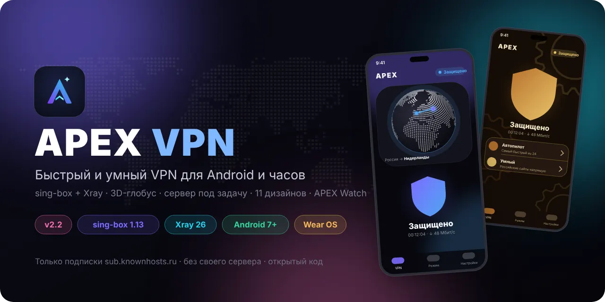

<br><br>

<a href="https://github.com/Dubstep2004/apex-vpn/releases/latest"></a>
<a href="#setup"></a>
<a href="#whatsnew"></a>

<a href="#features"></a>
<a href="#designs"></a>
<a href="#original"></a>

<h3>Быстрый и умный VPN-клиент для Android и часов Wear OS</h3>

<p><b>Два ядра</b> · все популярные протоколы · <b>свои списки</b> с шаблонами · <b>3D-глобус</b> · <b>13 дизайнов</b> и свой цвет<br>
стабильный автопилот · DNS «Авто» · часы Wear OS · перенос по QR · без своего сервера</p>

<sub>Последняя версия — <b>2.3.0</b> · Android 7+ · sing-box 1.13 · Xray 26</sub>

</div>

---

> [!NOTE]
> APEX VPN работает только с подпиской `https://sub.knownhosts.ru/…`. Ссылку можно вставить, отсканировать по QR-коду или открыть через `apexvpn://import?url=…`.

<div align="center">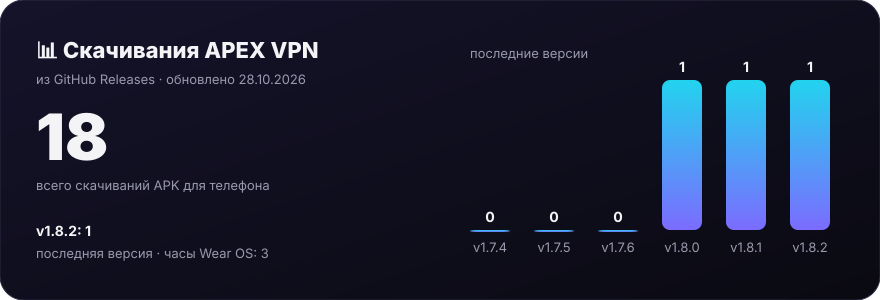</div>
<div align="center"><sub>Обновляется раз в день автоматически</sub></div>

<a id="setup"></a>


<table>
<tr>
<td width="33%" valign="top">

**📱 Пользователю**
Установить, обновлять, настроить.
<br>→ [Установка](#install)
<br>→ [Обновление](#update)
<br>→ [Свои списки сайтов](#lists)
<br>→ [Сервер под задачу](#task)
<br>→ [Тест скорости](#speed)
<br>→ [Облик 2.0: дизайн, цвет, звуки](#look)
<br>→ [Глобус, фото страны, темы](#globe)
<br>→ [Скрыть VPN от приложений](#hide)
<br>→ [Android TV](#tv)
<br>→ [APEX Watch (часы)](#watch)
<br>→ [Трафик, справка, Tasker](#traffic)
<br>→ [Космос, Японский, 3D-щит](#themes)
<br>→ [DNS «Авто» и автопилот](#dns)
<br>→ [Резервная копия](#backup)
<br>→ [Перенос на новый телефон](#transfer)
<br>→ [Очистить данные](#clear)
<br>→ [Ссылка-приглашение](#invite)

</td>
<td width="33%" valign="top">

**🧑‍💻 Владельцу**
Выпустить новую версию.
<br>→ [Выпуск версии](#release)
<br>→ [Ключ подписи](#signing)
<br>→ [Объявления](#announce)

</td>
<td width="33%" valign="top">

**❓ Помощь**
Частые проблемы и поддержка.
<br>→ [Конец подписки](#expiry)
<br>→ [Написать в поддержку](#support)
<br>→ [Оригинал и подделки](#original)
<br>→ [Если что-то не так](#faq)

</td>
</tr>
</table>

> [!TIP]
> Каждая инструкция — отдельная вкладка: нажмите на заголовок, чтобы открыть.

<a id="install"></a>
<details open>
<summary><b>📲 Установка на телефон</b></summary>

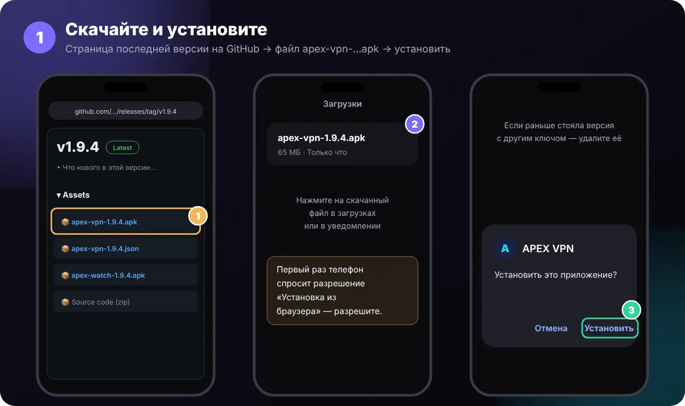

1. Откройте на телефоне **[последнюю версию](https://github.com/Dubstep2004/apex-vpn/releases/latest)**.
2. В разделе **Assets** нажмите **`apex-vpn-<версия>.apk`** — файл скачается.
3. Откройте скачанный файл и нажмите **«Установить»**. Первый раз телефон попросит разрешить установку из браузера — разрешите.
4. При первом запуске — короткое **знакомство** из трёх экранов → **«Начать»** (или «Пропустить»).
5. Вставьте ссылку подписки `https://sub.knownhosts.ru/…` или нажмите **«Сканировать QR-код»** — подходит и QR подписки, и [QR переноса со старого телефона](#transfer).
6. Проверьте подлинность: **Настройки → О приложении** — зелёная строка **«✓ Официальная сборка»** ([подробнее](#original)).
7. Переустанавливали приложение? **Настройки → Резервная копия → «Восстановить из файла»** — вернутся все настройки и подписка ([подробнее](#backup)).

> [!WARNING]
> Ошибка **«Приложение не установлено, так как оно конфликтует с другим пакетом»** — старая версия подписана другим ключом. Удалите APEX VPN (Настройки → Приложения → APEX VPN → Удалить) и установите заново. Это нужно **один раз**.

</details>

<a id="update"></a>
<details>
<summary><b>🔔 Как приходит обновление</b></summary>

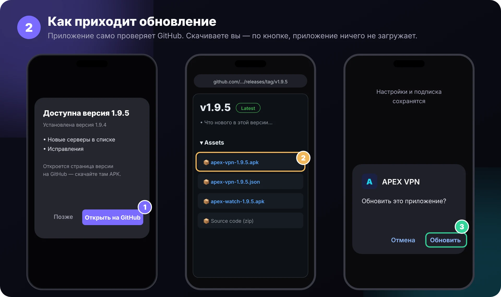

Приложение само проверяет GitHub — при запуске и раз в 3 часа.

1. Появляется окно **«Доступна версия …»** со списком изменений (и уведомление, если приложение закрыто).
2. Кнопка **«Открыть на GitHub»** открывает страницу этой версии: `github.com/Dubstep2004/apex-vpn/releases/tag/v<версия>`.
3. Скачайте `apex-vpn-<версия>.apk` и нажмите **«Обновить»**. Настройки и подписка сохранятся.

Само приложение **ничего не скачивает**. Проверить вручную: **Настройки → Обновления → Проверить сейчас**.

> [!NOTE]
> Проверка работает, пока репозиторий **публичный**. Если сделать его приватным, приложение не увидит новых версий.

</details>

<a id="lists"></a>
<details>
<summary><b>📋 Свои списки сайтов</b></summary>

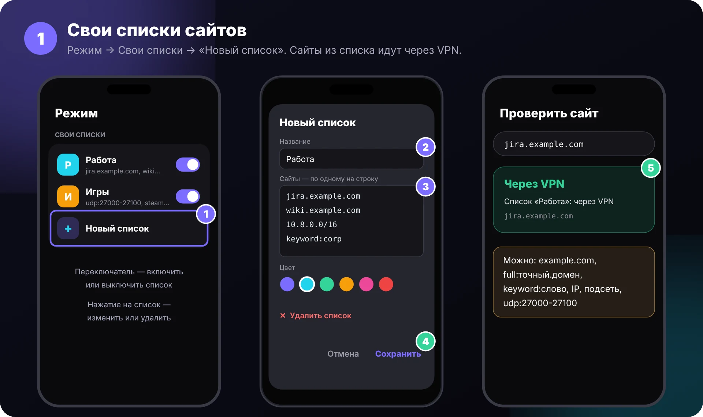

Свои наборы сайтов, которые идут **через VPN**: например «Работа» или «Игры».

1. Вкладка **Режим** → раздел **Свои списки** → **«Новый список»**.
2. Выберите **готовый шаблон** или **«Пустой список»**:
   - 🎮 **Игры** — Steam, Epic, Riot, Battle.net, EA, Ubisoft, PlayStation, Xbox, Nintendo, Roblox, Minecraft…
   - 🤖 **Нейросети** — Midjourney, Hugging Face, Mistral, Character.AI, Poe, Suno, ElevenLabs, Cursor…
   - 💼 **Работа** — Slack, Zoom, Atlassian, Microsoft 365, Asana, Miro, Canva, Dropbox…
   - 💻 **Разработка** — GitHub, GitLab, Docker, npm, PyPI, Stack Overflow, JetBrains…
   - 🎓 **Учёба**, 🎬 **Кино и сериалы**, 🎧 **Музыка**, 💬 **Соцсети**, 🛍️ **Покупки**

   Отметьте галочками несколько шаблонов и нажмите **«Добавить»** — они появятся сразу. Нажатие на шаблон открывает его для правки перед сохранением.
3. Проверьте **название** и **сайты** — добавьте своё или уберите лишнее.
   Сайты пишутся **по одному на строку**:
   - `example.com` — сайт со всеми поддоменами;
   - `full:mail.example.com` — только этот адрес;
   - `keyword:corp` — все сайты, где есть слово;
   - `10.8.0.0/16` или `1.2.3.4` — IP-адрес или подсеть;
   - `udp:27000-27100`, `tcp:25565` — порты (игры).
4. Выберите **цвет** и нажмите **«Сохранить»**.

Переключатель справа включает и выключает список. Нажатие на список — **изменить** или **удалить**. Проверить, куда пойдёт сайт: **Режим → Проверить сайт** — там будет написано, в каком списке сайт.

Рядом — **26 готовых сервисов** (YouTube, Instagram, Telegram, ChatGPT, Netflix, Spotify, Reddit, Signal, Viber, Notion, Figma и другие). Выключенный сервис идёт напрямую.

</details>

<a id="task"></a>
<details>
<summary><b>🎯 Сервер под задачу</b></summary>

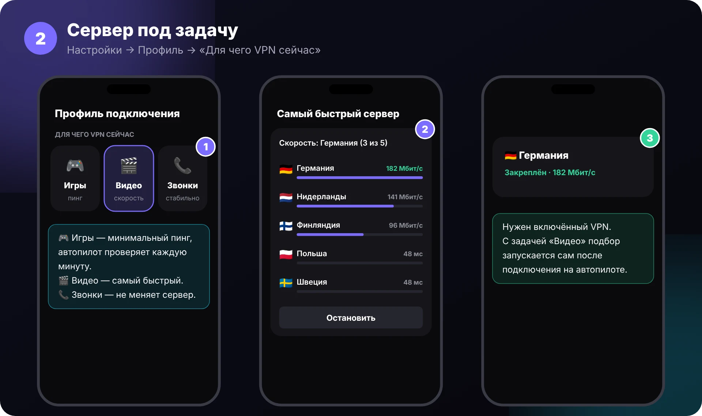

APEX сам настроит профиль и выбор сервера под то, чем вы заняты.

1. **Настройки → Профиль** → блок **«Для чего VPN сейчас»**.
2. Выберите задачу:
   - 🎮 **Игры** — автопилот каждую минуту ищет сервер с **самым низким пингом**, игры не обрываются при смене;
   - 🎬 **Видео** — APEX измеряет скорость **5 серверов с лучшим пингом** и **закрепляет самый быстрый**;
   - 📞 **Звонки** — сервер «залипает» и не меняется без нужды, связь не рвётся.
3. Нажмите на задачу ещё раз, чтобы снять её.

С задачей **«Видео»** подбор запускается сам после подключения на автопилоте. Подобрать заново: **Тест скорости → «Самый быстрый сервер» → «Подобрать снова»**.

> [!NOTE]
> Подбор работает только при **включённом VPN** (скорость меряется через сервер) и расходует около 30 МБ. После подбора выбран конкретный сервер — автопилот выключен, пока вы снова не выберете его в списке серверов.

</details>

<a id="speed"></a>
<details>
<summary><b>⚡ Тест скорости</b></summary>

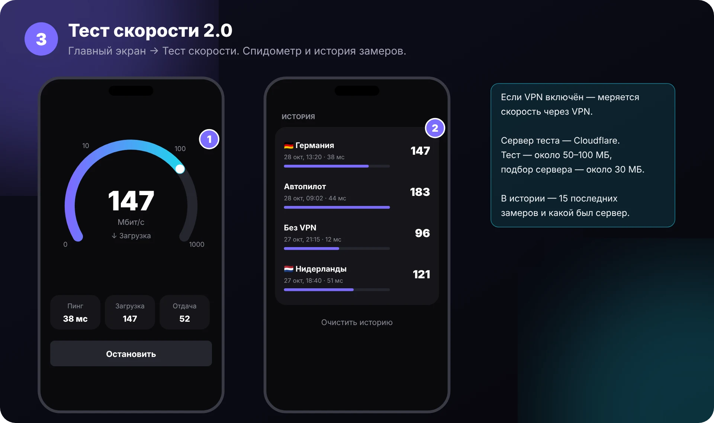

1. Главный экран → **«Тест скорости»** (или **Настройки → Тест скорости**).
2. **«Начать тест»** — спидометр покажет пинг, загрузку и отдачу. Шкала до 1000 Мбит/с.
3. Ниже — **история**: 15 последних замеров, дата, сервер и полоска относительно лучшего результата. **«Очистить историю»** — удалить.
4. Блок **«Самый быстрый сервер»** — подбор, как у задачи «Видео».

Если VPN включён — меряется скорость **через VPN**. Сервер теста — Cloudflare, тест расходует около 50–100 МБ.

</details>

<a id="look"></a>
<details>
<summary><b>🎨 Облик 2.0: дизайн, свой цвет, звуки</b></summary>

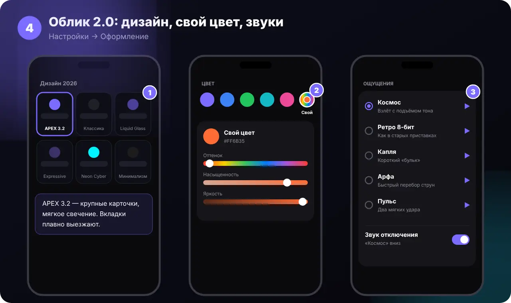

**Настройки → Оформление → «Дизайн, тема и иконка»**:

1. **Дизайн 2026 → APEX 2.3** — фирменный дизайн: крупные карточки и строки, мягкое свечение фона. Его название идёт за версией приложения. Дизайн по умолчанию для новых установок; у тех, кто обновился, остаётся прежний — его можно сменить здесь.
2. **Цвет → «Свой»** (радужный кружок) — ползунки **Оттенок**, **Насыщенность**, **Яркость** и 8 быстрых образцов. Пока тянете ползунок, меняется только образец; приложение перекрашивается, когда отпустите палец.
3. **Ощущения → Звук подключения** — 9 наборов: Сигнал, Кристалл, Сфера, Звон, **Космос**, **Ретро 8-бит**, **Капля**, **Арфа**, **Пульс**. ▶ — послушать.
4. **Звук отключения** — тот же набор «вниз» при выключении VPN. Нажмите на строку, чтобы послушать.

Вкладки внизу теперь плавно выезжают в сторону нажатой, а при запуске — **заставка 2.0**: щит рисуется линией, заливается цветом, появляется «APEX VPN 2.0». В **плавном режиме** анимации короче.

</details>

<a id="globe"></a>
<details>
<summary><b>🌍 Глобус, фото страны и новые темы</b></summary>

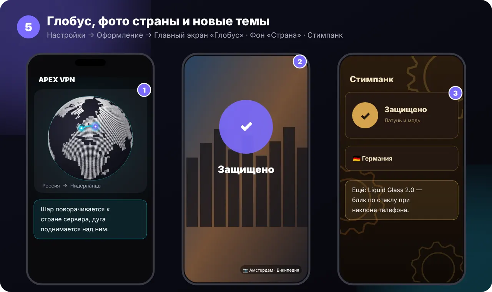

**Настройки → Оформление → «Дизайн, тема и иконка»**:

1. **Главный экран → «Глобус»** — вращающийся 3D-шар из точек. При смене сервера он поворачивается к его стране, дуга от вас до сервера поднимается над шаром, по ней бежит свет.
2. **Фон за щитом → «Страна»** — **фото дня**: каждый день новое фото города страны сервера (на автопилоте — вашей страны). Фото берутся из Википедии и загружаются раз в день; подпись внизу экрана.
3. **Дизайн → «Стимпанк»** — латунь, медь и медленно вращающиеся шестерёнки.
4. **Дизайн → «Liquid Glass 2.0»** — по стеклу карточек скользит блик, а цветные пятна за стеклом смещаются, когда вы наклоняете телефон.

Ещё в 2.1:
- смена дизайна, темы или цвета идёт **«волной»** — новые цвета растекаются кругом от места нажатия;
- **флаг переворачивается**, как карточка, когда меняется страна;
- **конфетти** на первом подключении и на юбилейных (10, 50, 100…);
- значки в настройках **«оживают»** при открытии;
- при первом запуске — **знакомство** из трёх экранов;
- на Android 12+ **живая иконка** на системной заставке.

> [!TIP]
> В приложении спрятана **секретная тема**. Подсказка: логотип в «О приложении» любит, когда на него нажимают 😉

В **плавном режиме** все эти анимации выключены или короче.

</details>

<a id="hide"></a>
<details>
<summary><b>🙈 Скрыть VPN от приложений</b></summary>

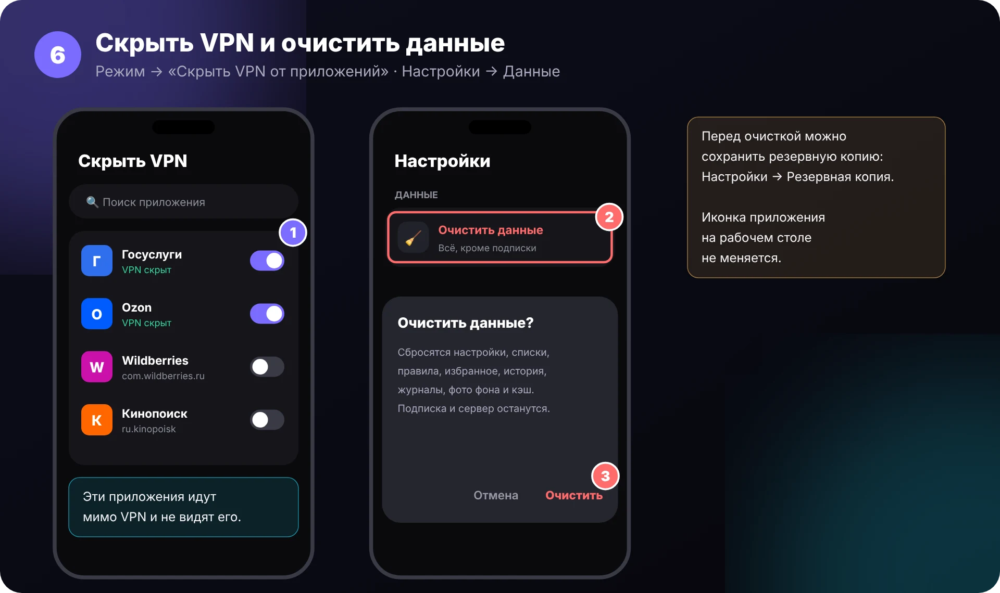

Некоторые приложения не работают с VPN (госуслуги, маркетплейсы, игры с защитой). Их можно пустить мимо VPN — тогда для них соединение обычное, и они не видят, что VPN включён.

1. Вкладка **Режим** → **«Скрыть VPN от приложений»**.
2. Найдите приложение поиском и включите переключатель.
3. Готово — VPN переподключится сам. Под названием будет **«VPN скрыт»**.

Банки скрываются отдельно — переключателем **«Банки не увидят VPN»** рядом.

</details>

<a id="tv"></a>
<details>
<summary><b>📺 Android TV</b></summary>

Установите тот же `apex-vpn-<версия>.apk` на телевизор с Android TV / Google TV (например, через «Отправить файлы на ТВ» или флешку). APEX VPN появится в списке приложений.

На телевизоре главный экран другой:
- **слева** — большой 3D-глобус с дугой до сервера;
- **в центре** — щит: **OK** на пульте включает и выключает VPN;
- **справа** — страны крупными карточками: стрелками выберите страну, **OK** — подключиться. Выбранная карточка увеличивается и светится.

Подписку на ТВ удобно добавить [ссылкой-приглашением](#invite) или [переносом по QR](#transfer).

</details>

<a id="watch"></a>
<details>
<summary><b>⌚ APEX Watch — часы Wear OS</b></summary>

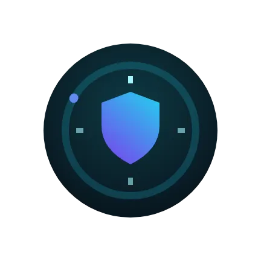

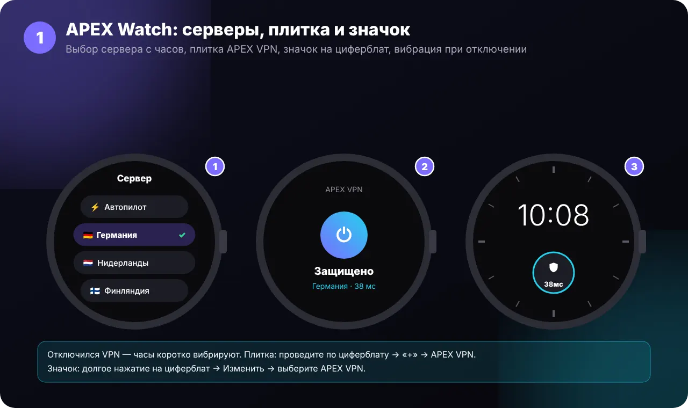

**APEX Watch** — пульт VPN на часах: кнопка включить/выключить, сервер, пинг и скорость. Работает вместе с APEX VPN на телефоне.

> [!WARNING]
> **`apex-watch-<версия>.apk` — только для часов.** Не открывайте его на телефоне: телефон покажет «APEX Watch — Обновить приложение?», но установить не даст (так и задумано — чтобы приложение для часов не заменило APEX VPN). На телефон ставится **`apex-vpn-<версия>.apk`**.

1. Откройте [последнюю версию](https://github.com/Dubstep2004/apex-vpn/releases/latest) и скачайте **`apex-watch-<версия>.apk`** на телефон — **не открывайте его**.
2. Передайте и установите на часы:
   - **Проще всего:** приложение **Wear Installer 2** на телефоне → включите на часах **Настройки → Для разработчиков → Отладка по Wi-Fi** → выберите файл `apex-watch-…apk` → **Установить на часы**;
   - **С компьютера:** `adb connect <IP часов>:<порт>`, затем `adb install apex-watch-<версия>.apk`.
3. На часах появится **APEX Watch** со своей иконкой — циферблат и щит.
4. **Сервер с часов:** пролистайте вниз → **«Сервер»** → выберите страну. Ниже — кнопка **GitHub** (откроется на телефоне).
5. **Плитка:** проведите по циферблату влево до конца → **«+»** → **APEX VPN**. Большая кнопка включает и выключает VPN.
6. **Значок на циферблат:** долгое нажатие на циферблат → **Изменить** → место для значка → **APEX VPN**. Показывает щит и пинг.
7. Если VPN отключился — часы **коротко вибрируют**.

Телефон и часы должны быть сопряжены, а APEX VPN — установлен на телефоне.

</details>

<a id="traffic"></a>
<details>
<summary><b>📊 Трафик по приложениям, справка и Tasker</b></summary>

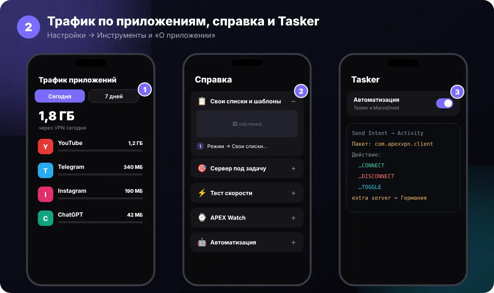

**Трафик по приложениям** (Android 10+): **Настройки → Инструменты → «Трафик по приложениям»** — какие приложения сколько потратили через VPN, **сегодня** и **за 7 дней**. Считается только то, что идёт через VPN; данные хранятся только на телефоне.

**Справка в приложении:** **Настройки → О приложении → «Справка»** — те же инструкции с картинками, что здесь, без интернета.

**Автоматизация (Tasker, MacroDroid):**
1. **Настройки → Инструменты → «Автоматизация»** — включите (по умолчанию выключено, чтобы чужие приложения не управляли VPN).
2. В Tasker: **Система → Send Intent**, *Target: Activity*, пакет `com.apexvpn.client`. В MacroDroid: **Запустить активность / Отправить интент**.
3. Действие (Action):
   - `com.apexvpn.client.CONNECT` — включить; extra `server` = название сервера (например `Германия`) или `auto`;
   - `com.apexvpn.client.DISCONNECT` — выключить;
   - `com.apexvpn.client.TOGGLE` — переключить.

Первое включение VPN всё равно нужно разрешить в самом приложении — так требует Android.

</details>

<a id="themes"></a>
<details>
<summary><b>🌌 Космос, Японский минимализм, 3D-щит и самолётик</b></summary>

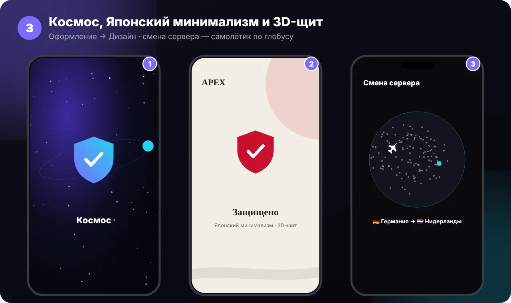

**Настройки → Оформление → «Дизайн, тема и иконка»**:
- **Космос** — мерцающие звёзды и туманность, вокруг щита летают две планеты и спутник;
- **Японский минимализм** — рисовая бумага, тушь, красный акцент и шрифт с засечками;
- **3D-щит** (раздел «Плавность») — щит поворачивается, когда вы наклоняете телефон;
- при смене сервера по **глобусу** и **карте** летит **самолётик** — от старой страны к новой.

</details>

<a id="dns"></a>
<details>
<summary><b>🧭 DNS «Авто», стабильный автопилот и объявления с картинкой</b></summary>

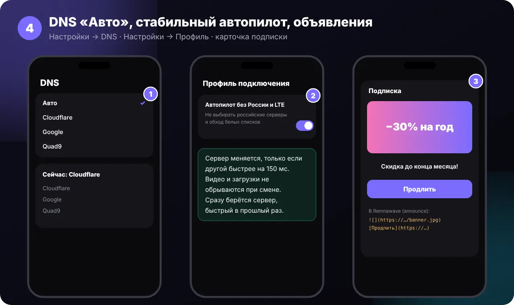

**DNS «Авто»:** **Настройки → DNS → «Авто»** (по умолчанию у новых установок). После каждого подключения APEX сравнивает **Cloudflare, Google и Quad9** и берёт самый быстрый; меняет DNS, только если другой заметно быстрее. Там же видно замер и кнопка **«Проверить сейчас»**.

**Стабильный автопилот:**
- не выбирает **серверы России и обход LTE** — у них самый низкий пинг, но заблокированные сайты через них не открываются (выключается в **Настройки → Профиль → «Автопилот без России и LTE»**);
- меняет сервер, только если другой быстрее **на 150 мс**, и **не обрывает** видео и загрузки при смене;
- при подключении сразу берёт сервер, который был быстрее **в прошлый раз**, а не первый в списке.

**Объявления с картинкой и кнопкой** — см. [Объявления](#announce).

</details>

<a id="backup"></a>
<details>
<summary><b>💾 Резервная копия настроек</b></summary>

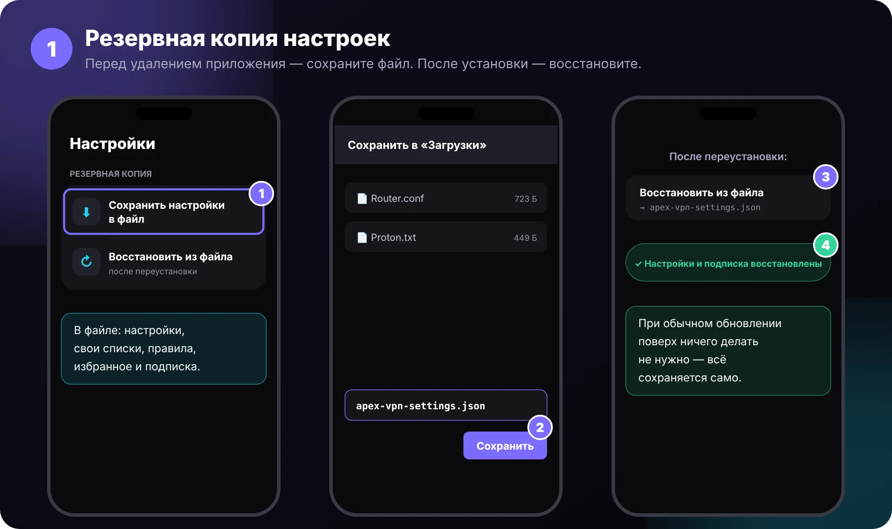

При **обновлении поверх** все настройки сохраняются сами. Копия нужна, если приложение приходится **удалять** (например, при ошибке «конфликтует с другим пакетом») или вы переходите на новый телефон.

1. **Настройки → Резервная копия → «Сохранить настройки в файл»** → выберите папку (например, «Загрузки») → **Сохранить**. Файл `apex-vpn-settings.json`.
2. После установки: **Настройки → Резервная копия → «Восстановить из файла»** → выберите файл.
3. Вернутся все настройки, свои списки, правила, избранное, дизайн и **подписка**.

Ещё настройки попадают в **резервную копию Android** (Google), если она включена на телефоне, и возвращаются при установке сами.

> [!WARNING]
> В файле есть ссылка вашей подписки — не отправляйте его другим. Чтобы поделиться VPN с семьёй, используйте [ссылку-приглашение](#invite).

</details>

<a id="transfer"></a>
<details>
<summary><b>📲 Перенос на новый телефон</b></summary>

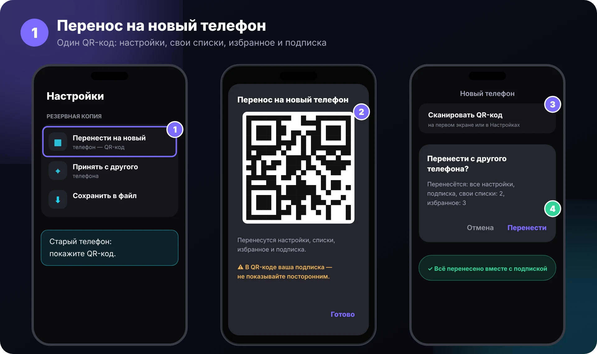

Без файлов и без интернета — одним QR-кодом.

1. **Старый телефон:** Настройки → Резервная копия → **«Перенести на новый телефон»**. Появится QR-код (яркость экрана станет максимальной).
2. **Новый телефон:** установите APEX VPN и нажмите **«Сканировать QR-код»** — на первом экране или в **Настройки → Резервная копия → «Принять с другого телефона»**.
3. Наведите камеру на QR-код. Появится окно со списком, что перенесётся, — нажмите **«Перенести»**.
4. Готово: вернутся **все настройки, свои списки, избранное, правила, выбранный сервер и подписка**.

> [!WARNING]
> В QR-коде ваша **личная подписка** — не показывайте его посторонним и не публикуйте скриншот. Если данных слишком много для одного QR, приложение предложит [файл](#backup).

</details>

<a id="expiry"></a>
<details>
<summary><b>⏰ Уведомления о конце подписки</b></summary>

APEX напомнит **три раза**: **за 3 дня**, **за 1 день** и **в момент окончания** — каждое уведомление один раз для каждой даты. Напоминания срабатывают точно по времени, даже если телефон без интернета. Ещё будет уведомление, если осталось меньше 10% трафика (не чаще раза в сутки).

Включить или выключить: **Настройки → Уведомления → «Конец подписки»**. Дату и обратный отсчёт видно в карточке подписки на главном экране.

</details>

<a id="clear"></a>
<details>
<summary><b>🧹 Очистить данные</b></summary>

**Настройки → Данные → «Очистить данные»** → **«Очистить»**.

Сбросятся все настройки, свои списки, правила, избранное, история тестов скорости, журналы, отчёты о сбоях, фото фона и кэш. **Подписка и выбранный сервер останутся**, иконка на рабочем столе не меняется.

> [!WARNING]
> Отменить нельзя. Если настройки могут понадобиться — сначала [сохраните резервную копию](#backup).

</details>

<a id="release"></a>
<details>
<summary><b>🛠️ Как выпустить новую версию</b></summary>

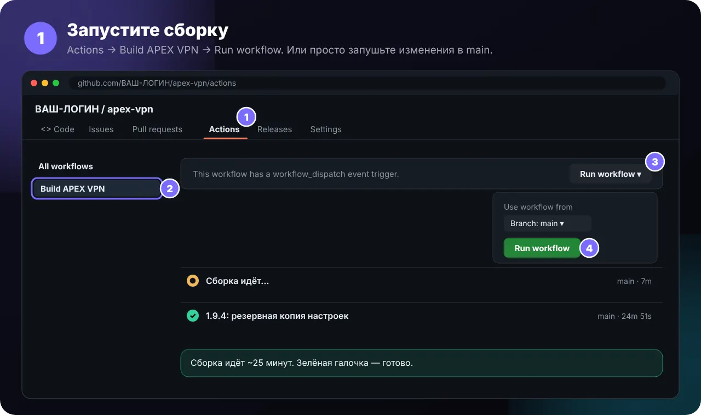

1. В `app/build.gradle.kts` увеличьте `versionCode` и `versionName`.
2. Добавьте запись в `app/src/main/java/com/apexvpn/client/data/Changelog.kt` — она станет описанием релиза и текстом в окне обновления.
3. Запушьте в `main` — или **Actions → Build APEX VPN → Run workflow**. Сборка идёт около 25 минут.
4. Готово: в **Releases** появится `v<версия>`, а у пользователей — окно «Доступна версия».

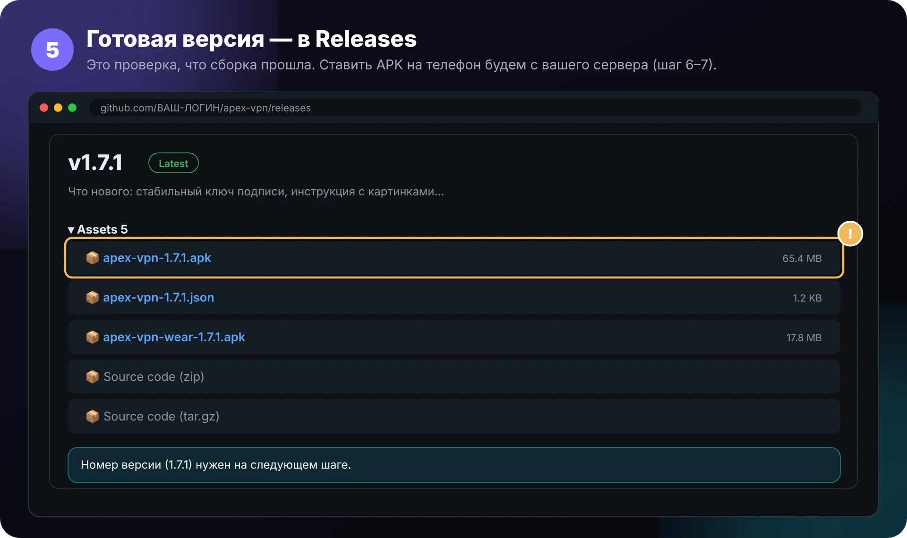

> [!TIP]
> **Обязательное обновление** (окно без кнопки «Позже»): откройте релиз на GitHub → **Edit** → допишите в описание `[обязательно]` → **Update release**.

</details>

<a id="signing"></a>
<details>
<summary><b>🔑 Ключ подписи (один раз)</b></summary>

Все версии должны быть подписаны **одним** ключом — иначе Android не поставит новую поверх старой.

- **Сейчас** сборки подписываются постоянным ключом, который хранится в кэше GitHub Actions (раз в неделю сборка сама его «освежает», чтобы GitHub не удалил).
- **Надёжнее** — добавить свой ключ в секреты GitHub. Тогда он не потеряется никогда.

<details>
<summary><b>Как добавить свой ключ</b></summary>

1. Создайте ключ на компьютере с Java: `bash scripts/make-keystore.sh` (запомните пароль), затем `base64 -w0 apex-release.jks` — это значение для `APEX_KEYSTORE_BASE64`.
2. GitHub → **Settings → Secrets and variables → Actions → Secrets → New repository secret**:

| Name | Secret |
|---|---|
| `APEX_KEYSTORE_PASSWORD` | пароль ключа |
| `APEX_KEYSTORE_BASE64` | длинная строка целиком |

3. Запустите сборку. **Один раз** после смены ключа на телефонах нужно удалить старую версию и поставить новую.

> [!CAUTION]
> Ключ и пароль никому не отправляйте и не загружайте в репозиторий — только в секреты GitHub. Сохраните копию: без него обновления не встанут поверх.

</details>

</details>

<a id="announce"></a>
<details>
<summary><b>📢 Объявления для пользователей</b></summary>

Объявление показывается **в карточке подписки внизу главного экрана** приложения.

#### Через Remnawave

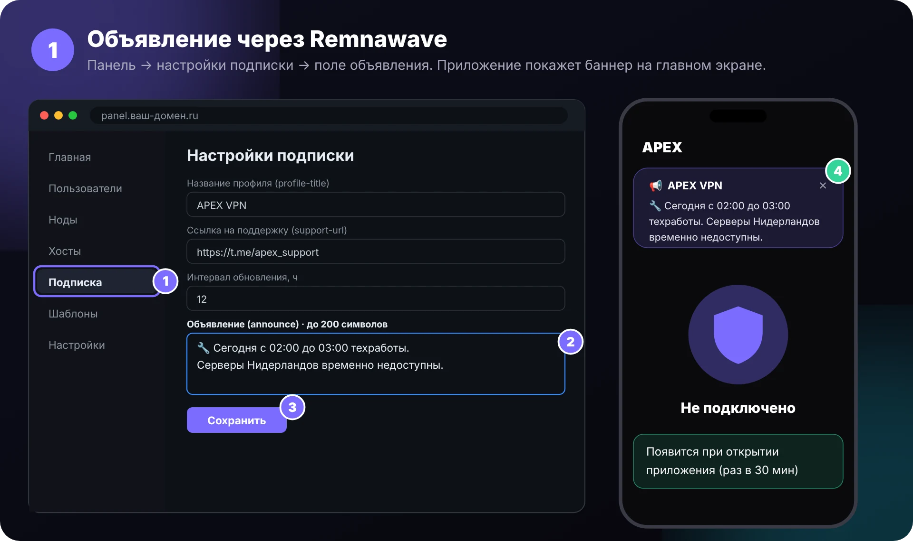

1. Откройте панель Remnawave → **Подписка** (настройки подписки).
2. Впишите текст в поле **объявления (announce)** — то же поле, что для Happ. До 200 символов, эмодзи можно.
3. Нажмите **Сохранить**.
4. Пользователи увидят текст при следующем открытии приложения (подписка обновляется, если прошло больше 30 минут) или при обновлении подписки кнопкой ↻.

**Убрать объявление:** очистите поле или впишите `0`.

**Картинка и кнопка** (с версии 2.3): допишите в текст объявления
- `` — картинка над текстом (только `https`, до 5 МБ);
- `[Продлить](https://ваш-сайт/pay)` — кнопка под текстом (ссылка `https://` или `tg://`).

Пример: `Скидка до конца месяца!  [Продлить](https://site/pay)`. То же можно передать заголовками `announce-image`, `announce-url`, `announce-button` (правило ответа в Remnawave).

> [!TIP]
> Если в вашей версии панели нет поля объявления — добавьте **свой заголовок ответа**: `announce: Текст` (или `announce: base64:…` для длинного текста с переносами). Ещё можно добавить строку `#announce: Текст` в начало тела подписки.

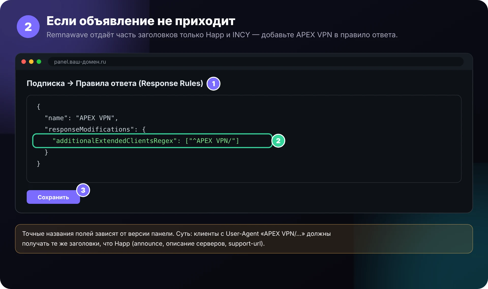

**Если объявление не приходит:** Remnawave отдаёт часть заголовков (объявление, описания серверов) только Happ и INCY. Добавьте правило ответа с `additionalExtendedClientsRegex: ["^APEX VPN/"]` — тогда APEX VPN получает то же, что Happ.

</details>

<a id="invite"></a>
<details>
<summary><b>💌 Ссылка-приглашение</b></summary>

Одна ссылка, по которой человек **скачивает приложение и сразу добавляет подписку**. Удобно для своего второго телефона или семьи.

**В приложении:** Настройки → Подписка → **«Ссылка-приглашение»** → отправить в любой мессенджер.

**Без приложения:** откройте страницу `https://dubstep2004.github.io/apex-vpn/invite/`, вставьте ссылку подписки — получите ссылку-приглашение и QR-код.

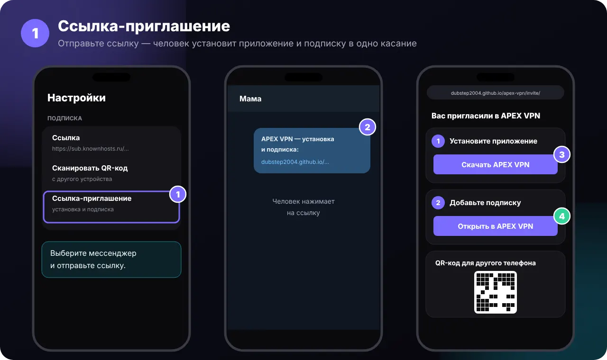

По ссылке открывается страница с тремя шагами: **Скачать APEX VPN** → **Открыть в APEX VPN** (подписка добавится сама) → QR-код для другого телефона.

> [!IMPORTANT]
> **Один раз включите страницу:** GitHub → **Settings → Pages** → Source: **Deploy from a branch** → Branch: **main**, папка **/docs** → **Save**. Через пару минут страница заработает по адресу выше.

> [!NOTE]
> Ссылка подписки стоит в приглашении **после знака `#`** — браузер не отправляет эту часть на сервер GitHub, она остаётся только на телефоне. Но по приглашению подключаются к **вашей** подписке — делитесь только с теми, кому доверяете.

</details>

<a id="support"></a>
<details>
<summary><b>🎧 Написать в поддержку</b></summary>

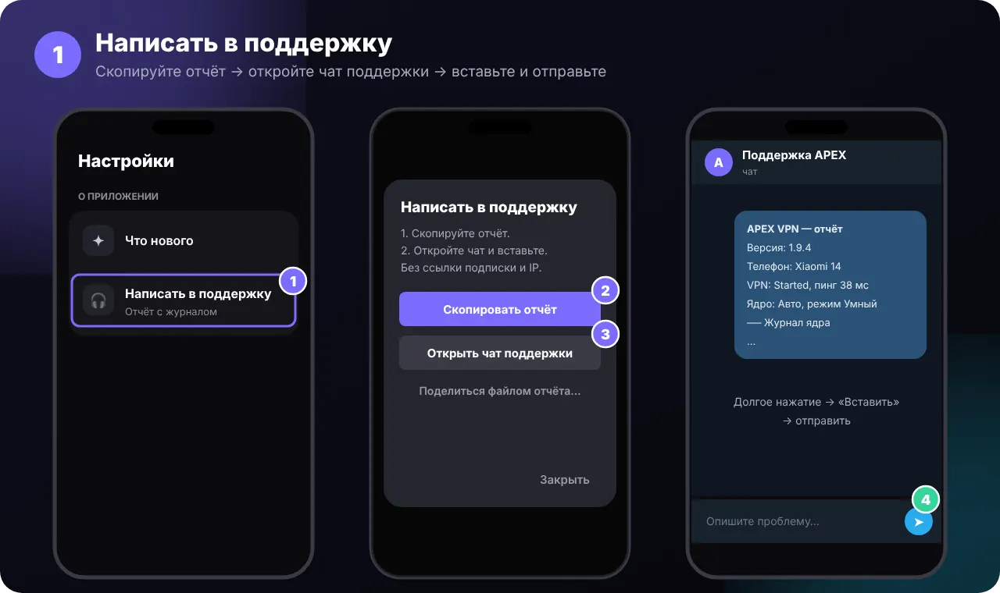

1. В приложении: **Настройки → Написать в поддержку**.
2. **«Скопировать отчёт»** — отчёт попадёт в буфер обмена. В нём версия, модель телефона, настройки, ошибки и журнал ядра. **Без ссылки подписки, адресов серверов и IP.**
3. **«Открыть чат поддержки»** — откроется чат из ссылки `support-url` вашей подписки (например, Telegram).
4. Долгое нажатие в поле сообщения → **«Вставить»** → опишите проблему → отправьте.

Кнопка **«Поделиться файлом отчёта…»** — если удобнее отправить файлом.

> [!IMPORTANT]
> **Для владельца:** кнопка «Открыть чат поддержки» появляется, только если в Remnawave заполнена **ссылка на поддержку (support-url)** в настройках подписки — например `https://t.me/ваш_бот_поддержки`. Без неё работает «Скопировать отчёт»: пользователь вставит его в любой чат. Если ссылка не приходит — проверьте [правило ответа](#announce) для `^APEX VPN/`.

</details>

<a id="original"></a>
<details>
<summary><b>🛡️ Оригинал и защита от подделок</b></summary>

Оригинальный APEX VPN скачивается **только** со страницы [Releases](https://github.com/Dubstep2004/apex-vpn/releases). Все версии подписаны ключом автора.

**Как проверить:** **Настройки → О приложении** — у оригинала зелёная строка **«✓ Официальная сборка»**.

Если кто-то перепакует APK (добавит рекламу, слежку или кражу подписки) и подпишет своим ключом, приложение это заметит:
- при каждом запуске покажет окно **«⚠ Неофициальная копия»** с кнопкой **«Скачать оригинал»**;
- на главном экране будет красная плашка, в уведомлении VPN — предупреждение;
- в отчёте для поддержки будет пометка **«НЕОФИЦИАЛЬНАЯ»** — поддержка сразу поймёт, в чём дело.

Сертификат подписи оригинала (SHA-256) — проверка на компьютере: `apksigner verify --print-certs файл.apk`

```
61:15:D6:55:A0:8D:FE:7C:97:0B:E7:DF:C1:1E:06:E3:5F:7E:C8:B8:BD:78:FF:5A:B7:82:F6:51:45:B1:00:D4
```

**Название и логотип.** Код открыт по GPL-3.0, но название «APEX VPN», логотип и иконки под эту лицензию не передаются — подробно в [TRADEMARKS.md](TRADEMARKS.md). Свою версию можно делать только под **другим названием и с другим логотипом**.

> [!IMPORTANT]
> **Для владельца:** проверка подписи работает, пока релизы подписываются вашим ключом из секретов `APEX_KEYSTORE_BASE64` / `APEX_KEYSTORE_PASSWORD`. Не удаляйте эти секреты и храните копию ключа: если ключ поменяется, отпечаток в `app/src/main/java/com/apexvpn/client/data/Integrity.kt` нужно обновить, иначе приложение назовёт свои же сборки копией.

</details>

<a id="faq"></a>
<details>
<summary><b>❓ Если что-то не так</b></summary>

| Проблема | Что делать |
|---|---|
| Настройки пропали после переустановки | **Перед удалением:** Настройки → Резервная копия → **«Сохранить настройки в файл»**. После установки — **«Восстановить из файла»**. При обычном обновлении поверх настройки сохраняются сами. |
| «Конфликтует с другим пакетом» | Удалите APEX VPN один раз и установите заново. Чтобы не повторялось — [свой ключ подписи](#signing). |
| Нет окна об обновлении | **Настройки → Обновления → Проверить сейчас**. Репозиторий должен быть публичным. «GitHub временно ограничил проверки» — подождите час. |
| Кнопка «Открыть на GitHub» не работает | Нужен браузер на телефоне. Или откройте вручную [страницу версий](https://github.com/Dubstep2004/apex-vpn/releases). |
| Сборка на GitHub красная | Откройте сборку в **Actions** — ошибка написана в блоке **Annotations**. |
| Приложение вылетает / не подключается | **Настройки → Написать в поддержку → «Скопировать отчёт»**, затем **«Открыть чат поддержки»** и вставьте отчёт в сообщение. В отчёте нет ссылки подписки и IP. |
| Нет кнопки «Открыть чат поддержки» | Ссылку на чат задаёт сервис: в Remnawave заполните **ссылку на поддержку (support-url)** в настройках подписки. |
| Нет фото страны | Нужен интернет; фото загружается раз в день. Для некоторых стран фото нет — тогда фон без фото. |
| Приложение не работает с VPN | Вкладка **Режим → «Скрыть VPN от приложений»** — отметьте его. |
| QR переноса не сканируется | Увеличьте яркость, держите телефон ровно на 15–25 см. Не получается — [перенос файлом](#backup). |
| «Подключите VPN — скорость меряется через сервер» | Подбор самого быстрого сервера работает только при включённом VPN. |
| Не приходят напоминания о подписке | Разрешите APEX VPN уведомления и проверьте **Настройки → Уведомления → «Конец подписки»**. |
| Объявление из Remnawave не видно | Обновите подписку (↻ на карточке) и проверьте [правило ответа](#announce) для `^APEX VPN/`. |

</details>

<a id="features"></a>


<div align="center">
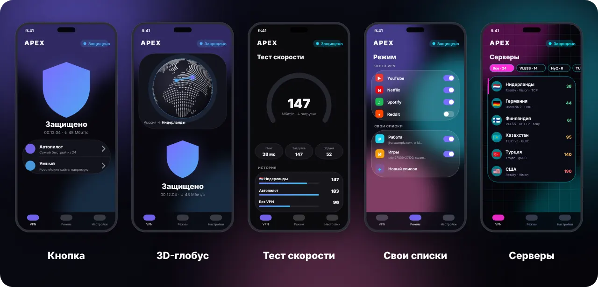
<br><sub>Иллюстрации интерфейса</sub>
</div>

<table>
<tr>
<td width="50%" valign="top">

### 🛡️ Подключение
- **Стабильный автопилот** выбирает самый быстрый сервер (без России и LTE-обхода), не прыгает между серверами и не рвёт соединения
- **DNS «Авто»** — сам выбирает самый быстрый: Cloudflare, Google или Quad9
- **Смена сервера без разрыва** VPN
- **Аварийный выключатель**: если VPN упал, интернет закрыт до переподключения
- **Профили**: Обычный, Игры, Звонки, Экономия батареи
- **Сервер под задачу**: Игры — пинг, Видео — подбор самого быстрого, Звонки — стабильность

</td>
<td width="50%" valign="top">

### 🧭 Маршрутизация
- **Умный режим**: российские сайты и IP идут напрямую
- **Сервисы через VPN**: 26 готовых (YouTube, Instagram, Telegram, ChatGPT, Netflix, Spotify…) и **свои списки** сайтов с готовыми шаблонами (Игры, Нейросети, Работа…)
- **Для опытных**: свои правила, FakeDNS, стратегия доменов, DoH / DoT / DoQ
- **Банки не увидят VPN**, выбор приложений

</td>
</tr>
<tr>
<td valign="top">

### 🗺️ Главный экран
- **Кнопка**, **Карта** или **3D-глобус** с дугой от вас до сервера; фон **«Фото страны»**
- **Живая карта**: дышащие кольца и бегущий по дуге свет
- Живой график пинга, скорость, таймер отключения, **счётчик заблокированной рекламы**
- Карточка подписки: трафик, **обратный отсчёт** до конца, объявления из Remnawave, поддержка
- Свайп по щиту — другой сервер; анимации «тоннель» и «щит закрывается»

</td>
<td valign="top">

### 🎨 Оформление и ощущения
- **13 дизайнов** (APEX 2.3, **Космос**, **Японский минимализм**, **Стимпанк**, **Liquid Glass 2.0** с бликами от наклона) и секретная тема, **3D-щит**, 4 темы, 5 цветов и **любой свой цвет**, 8 иконок, своё фото на фон
- **9 наборов звуков** подключения и отключения (на беззвучном телефон молчит), **заставка 2.0**
- **Вибрация**, **плавный режим**, **размытие стекла**, живое название APEX VPN
- Фон за щитом: волны, частицы, звёзды; **живые обои**; анимированные флаги

</td>
</tr>
<tr>
<td valign="top">

### 📡 Серверы
- Фильтр по протоколу с числом серверов
- Настоящий пинг через VPN, а без VPN проверка по TCP / QUIC
- Описания серверов в формате Happ; серверы с рекламой собраны в отдельный раздел
- Избранное, вкладка «Только LTE», ярлыки серверов

</td>
<td valign="top">

### 🧩 Удобство
- Плитка в шторке, 4 виджета (в том числе 4×2 с серверами), **APEX Watch** для часов Wear OS, **Android TV 2.0**
- **Скрыть VPN от приложений**, **очистка данных** одной кнопкой, знакомство при первом запуске
- **Трафик по приложениям**, **справка** с картинками, **Tasker / MacroDroid**
- **APEX Watch**: выбор сервера, плитка, значок на циферблат, вибрация при отключении
- Голос: «включи VPN в APEX VPN»
- **Перенос на новый телефон одним QR**, резервная копия в файл, **ссылка-приглашение**, **WARP-цепочка**
- **Тест скорости 2.0** со спидометром и историей; напоминания за 3 дня и за 1 день до конца подписки
- Правила Wi-Fi, раздача VPN на компьютер
- Блокировка рекламы, **семейный режим** (18+, казино), «Написать в поддержку» с отчётом

</td>
</tr>
</table>

<a id="designs"></a>


<div align="center">
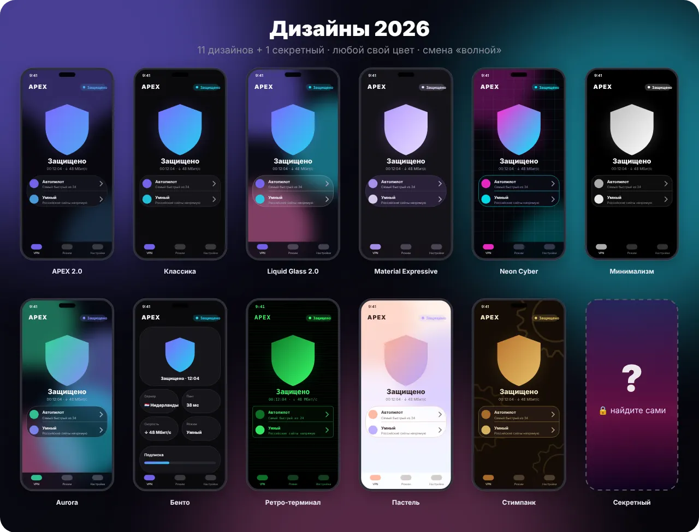
</div>

| Дизайн | Характер |
|---|---|
| **APEX 2.3** ✨ | фирменный облик: крупные карточки, мягкое свечение, цвет — любой; название идёт за версией |
| **Классика** | спокойный тёмный или светлый |
| **Liquid Glass 2.0** | стекло, блик и пятна двигаются при наклоне телефона |
| **Material Expressive** | цвет берётся из обоев (Android 12+) |
| **Neon Cyber** | неоновая сетка, розовый и голубой |
| **Минимализм** | только чёрное и белое |
| **Aurora** | плывущее северное сияние |
| **Бенто** | главный экран из плиток |
| **Ретро-терминал** | зелёный моноширинный шрифт |
| **Пастель** | светлый и мягкий |
| **Стимпанк** | латунь, медь и вращающиеся шестерёнки |
| **Космос** ✨ | звёзды, туманность, планеты и спутник вокруг щита |
| **Японский минимализм** ✨ | рисовая бумага, тушь, красный акцент, шрифт с засечками |
| **???** 🔒 | секретная тема — откройте сами |

Выбирается здесь: **Настройки → Оформление → «Дизайн, тема и иконка»**. Там же **свой цвет** (радужный кружок «Свой»), тема (светлая, тёмная, AMOLED, как в системе), иконка приложения и фон за щитом. Смена идёт «волной» от места нажатия.

<a id="protocols"></a>

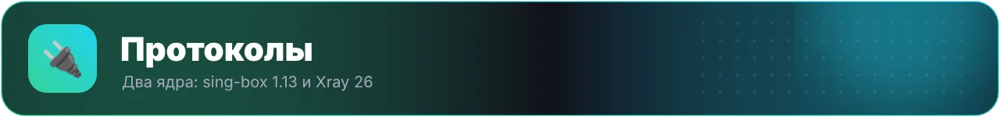

Два ядра, как в Happ: **sing-box 1.13.21** и **Xray 26**. Выбор в **Настройки → Ядро**:
- **Авто**: Xray включается только для того, что не умеет sing-box;
- **Только Xray**;
- **Только sing-box**.

| | |
|---|---|
| **VLESS** | Reality, Vision, WS, gRPC, HTTP/2, HTTPUpgrade, QUIC, **XHTTP**, **VLESS Encryption** |
| **VMess · Trojan** | все транспорты, **mKCP** через Xray |
| **Hysteria · Hysteria 2** | со сменой портов и Salamander |
| **TUIC · WireGuard · AnyTLS** | |
| **NaiveProxy · ShadowTLS · SSH** | |
| **SOCKS 4/5 · HTTP(S)** | цепочки серверов (detour) из JSON-подписок |

<details>
<summary>Не поддерживается</summary>

- ShadowsocksR и AmneziaWG: их нет в ядрах.
- Shadowsocks скрыт в приложении.

</details>

<a id="build"></a>


Обычная сборка — через GitHub Actions, см. **[Как выпустить новую версию](#release)**.

<details>
<summary><b>Локально</b></summary>

Нужны JDK 17, Go 1.25+, Android SDK и NDK `28.0.13004108`.

```bash
export ANDROID_HOME=~/Android/Sdk
./core/build-core.sh                      # ядро → app/libs/libbox.aar
./core/fetch-xray.sh                      # Xray → jniLibs
./gradlew assembleRelease
```

</details>

<details>
<summary><b>Структура проекта</b></summary>

```
app/                    Android-приложение (Kotlin, Jetpack Compose)
  …/vpn/                VpnService, ядра sing-box и Xray, виджеты, ярлыки
  …/data/               подписка, настройки, пинг, звуки, обновление баз
  …/update/             обновление приложения
  …/ui/                 экраны, темы, карта
wear/                   APEX Watch — приложение для часов Wear OS
core/apexcore/          Go: разбор подписки → конфиги sing-box и Xray (+ тесты)
.github/workflows/      сборка APK
```

</details>

<details>
<summary><b>Подписка и Remnawave</b></summary>

**Объявление через Remnawave** — см. [Объявления для пользователей](#announce).

- Приложение понимает base64-список ссылок, обычный список и JSON sing-box.
- Заголовки ответа: `profile-title`, `announce`, `support-url`, `profile-web-page-url`, `subscription-userinfo`, `profile-update-interval`. Их можно передать и строками `#имя: значение` в теле подписки.
- User-Agent: `APEX VPN/<версия>`.
- Remnawave отдаёт «Описание сервера» только Happ и INCY. Чтобы его видел APEX, добавьте правило ответа (Response Rule) с `additionalExtendedClientsRegex: ["^APEX VPN/"]`.

</details>

<details>
<summary><b>Отчёты о сбоях и приватность</b></summary>

Своего сервера у приложения нет, и оно никуда не отправляет данные само. Ошибки и сбои сохраняются **только на телефоне** (30 дней). Пользователь сам отправляет отчёт кнопкой **Настройки → Написать в поддержку**: в нём модель телефона, версия, настройки и журнал ядра — без ссылки подписки, адресов серверов и IP.

</details>

<a id="whatsnew"></a>


    

### 2.3.0 · 28 октября 2026


- DNS «Авто»: приложение само выбирает самый быстрый — Cloudflare, Google или Quad9 (Настройки → DNS)
- APEX Watch: выбор сервера прямо с часов
- APEX Watch: плитка — состояние, сервер и большая кнопка включения
- APEX Watch: значок на циферблат — щит и пинг
- APEX Watch: часы коротко вибрируют, если VPN отключился
- Трафик по приложениям: кто сколько потратил через VPN — сегодня и за 7 дней (Android 10+)
- Справка в приложении: инструкции с картинками — Настройки → О приложении → Справка
- Автоматизация: Tasker и MacroDroid могут включать, выключать VPN и менять сервер
- 3D-щит поворачивается, когда вы наклоняете телефон
- Тема «Космос»: звёзды, туманность и планеты со спутником вокруг щита
- Тема «Японский минимализм»: рисовая бумага, тушь, красный акцент и шрифт с засечками
- При смене сервера по глобусу и карте летит самолётик — от старой страны к новой
- Объявления из панели с картинкой и кнопкой


- Стабильный автопилот: не выбирает серверы России и обход LTE, меняет сервер только если другой заметно быстрее и не обрывает видео и загрузки при смене
- Автопилот при подключении сразу берёт сервер, который был быстрее при прошлом замере, а не первый в списке


- Фирменный дизайн теперь называется по версии приложения — «APEX 2.3», и в заставке тоже

#### 📚 Все версии (38)

Каждая версия — отдельная вкладка.

<details>
<summary><b>2.2.3</b> · 28 октября 2026</summary>


- Если APEX Watch всё же открыли на телефоне — он подскажет, какой файл нужен для телефона
- На странице версии подписано, какой файл для телефона, а какой — только для часов


- APEX Watch больше нельзя по ошибке установить на телефон поверх APEX VPN: Android откажет в установке

</details>

<details>
<summary><b>2.2.2</b> · 28 октября 2026</summary>


- Настройки → О приложении: ссылка на наш GitHub
- APEX Watch: кнопка «GitHub» — ссылка открывается на телефоне; список на часах листается колёсиком

</details>

<details>
<summary><b>2.2.1</b> · 28 октября 2026</summary>


- Приложение для часов теперь называется «APEX Watch» и получило свою иконку: циферблат и щит
- Файл для часов на странице версии: apex-watch-<версия>.apk

</details>

<details>
<summary><b>2.2.0</b> · 28 октября 2026</summary>


- Защита от подделок: приложение проверяет свою подпись и узнаёт перепакованные копии
- Неофициальная копия при каждом запуске предупреждает и даёт ссылку на оригинал; красная плашка на главном и в уведомлении
- «Настройки → О приложении»: «✓ Официальная сборка» у оригинала
- В отчёте для поддержки видно, официальная ли сборка


- Сборка на GitHub не выпустит релиз, подписанный не ключом автора


- Название и логотип APEX VPN не передаются по GPL — правила для форков в TRADEMARKS.md

</details>

<details>
<summary><b>2.1.1</b> · 28 октября 2026</summary>


- Liquid Glass 2.0: датчик наклона работает только пока приложение открыто — меньше расход батареи
- 3D-глобус рисуется экономнее — плавнее и меньше нагружает телефон


- Смена дизайна, темы или цвета «волной» могла закрыть приложение — исправлено
- Конфетти иногда застывало на экране и не исчезало
- У тех, кто обновился, конфетти «Первое подключение» больше не появляется по ошибке
- Восстановление из файла или QR с той же подпиской теперь возвращает и выбранный сервер
- Кнопка «Остановить» останавливает и подбор сервера, который запустился сам после подключения
- «Волна» при смене оформления перекрашивает и фон, а не только карточки

</details>

<details>
<summary><b>2.1.0</b> · 28 октября 2026</summary>


- Знакомство при первом запуске: три экрана с анимацией — щит, маршрутизация и глобус
- Главный экран «Глобус»: вращающийся 3D-шар из точек поворачивается к стране сервера
- Фон «Фото страны»: каждый день новое фото города страны сервера из Википедии
- Liquid Glass 2.0: по стеклу карточек скользит блик, фон смещается при наклоне телефона
- Новый дизайн «Стимпанк»: латунь, медь и вращающиеся шестерёнки
- Смена темы «волной»: новые цвета растекаются кругом от места нажатия
- Флаг переворачивается, как карточка, при смене страны
- Конфетти на первом подключении и юбилейных — 10, 50, 100…
- Значки в настройках «оживают» при открытии
- «Скрыть VPN от приложений»: свой список приложений, которые идут мимо VPN
- «Очистить данные»: всё, кроме подписки, одной кнопкой
- Android TV 2.0: глобус, крупный щит и страны большими карточками для пульта
- Живая иконка на системной заставке Android 12+
- Пасхалка: секретная тема — найдите сами 😉

</details>

<details>
<summary><b>2.0.0</b> · 28 октября 2026</summary>


- Новый дизайн «APEX 2.0»: крупные карточки и строки, мягкое свечение фона
- Вкладки плавно выезжают в сторону нажатой, выделение в нижнем меню переезжает, значок подпрыгивает
- Свой цвет акцента: любой оттенок, насыщенность и яркость, плюс быстрые образцы
- Заставка 2.0: щит рисуется линией, заливается градиентом, затем по буквам появляется «APEX VPN 2.0»
- Сервер под задачу: «Игры» — минимальный пинг, «Видео» — самый быстрый сервер, «Звонки» — стабильная связь
- Подбор самого быстрого сервера: APEX меряет скорость 5 лучших серверов и закрепляет быстрый
- Тест скорости 2.0: спидометр со стрелкой и история последних замеров
- Перенос на новый телефон одним QR-кодом: настройки, свои списки, избранное и подписка
- 5 новых наборов звуков: Космос, Ретро 8-бит, Капля, Арфа, Пульс
- Звук отключения VPN из того же набора


- Уведомления о конце подписки приходят точно за 3 дня, за 1 день и в день окончания — даже без интернета

</details>

<details>
<summary><b>1.9.6</b> · 28 октября 2026</summary>


- Готовые шаблоны своих списков: Игры, Нейросети, Работа, Разработка, Учёба, Кино, Музыка, Соцсети, Покупки
- Несколько шаблонов можно добавить разом, а любой — сначала открыть и изменить

</details>

<details>
<summary><b>1.9.5</b> · 28 октября 2026</summary>


- С фото за щитом на главном экране не тратится батарея на невидимую анимацию


- После восстановления из файла возвращается и выбранный сервер, а не автопилот
- Сохранение настроек в файл работает и в папках, которые не поддерживают перезапись
- Виджет 4×2 подсвечивает выбранную страну, даже если выбран другой сервер этой страны

</details>

<details>
<summary><b>1.9.4</b> · 28 октября 2026</summary>


- Резервная копия настроек в файл и восстановление: Настройки → Резервная копия
- Настройки и подписка попадают в резервную копию Android и возвращаются после переустановки


- Одна ошибка в сохранённых настройках больше не сбрасывает все настройки

</details>

<details>
<summary><b>1.9.3</b> · 28 октября 2026</summary>


- Цветные метки в «Что нового»: Новое, Улучшено, Изменено, Исправлено, Удалено


- Вся история версий размечена по видам изменений


- Описание новых версий на GitHub — с теми же метками

</details>

<details>
<summary><b>1.9.2</b> · 28 октября 2026</summary>


- Обновление подписки могло стереть всё избранное
- Свайп по щиту и виджет 4×2 не видели избранные серверы
- «Ссылка-приглашение» без подписки показывает подсказку вместо пустой ссылки

</details>

<details>
<summary><b>1.9.1</b> · 28 октября 2026</summary>


- Новые сервисы «Через VPN»: Netflix, Spotify, SoundCloud, Reddit, LinkedIn, Pinterest, Snapchat, Signal, Viber, Medium, Patreon, Perplexity, Copilot, Notion, Figma
- Свои списки: создайте список сайтов («Работа», «Игры»), включайте, меняйте и удаляйте


- «Проверить сайт» показывает, в каком своём списке сайт

</details>

<details>
<summary><b>1.9.0</b> · 28 октября 2026</summary>


- Обратный отсчёт до конца подписки: «Осталось 12 дней 4 ч»
- Своё фото из галереи на главный экран («Оформление → Фон за щитом»)
- Новые иконки: Космос, Минимал, Градиент
- Анимация «тоннель» при подключении и «щит закрывается» при отключении
- Избранное само очищается от серверов, которых больше нет в подписке
- Счётчик заблокированной рекламы за день на главном экране
- Ссылка-приглашение: установка приложения и подписка в одно касание

</details>

<details>
<summary><b>1.8.2</b> · 28 октября 2026</summary>


- Живое название APEX VPN: блик по буквам, переливающееся «VPN» и «дышащий» логотип


- «Написать в поддержку»: скопировать отчёт, открыть чат поддержки из подписки или отправить файл

</details>

<details>
<summary><b>1.8.1</b> · 28 октября 2026</summary>


- Объявление из Remnawave снова внизу — в карточке подписки, как раньше

</details>

<details>
<summary><b>1.8.0</b> · 28 октября 2026</summary>


- Работает без своего сервера: обновления — с GitHub, объявления — из Remnawave
- Отчёты о сбоях хранятся на телефоне и попадают в «Написать в поддержку» — приложение ничего не отправляет само

</details>

<details>
<summary><b>1.7.6</b> · 28 октября 2026</summary>


- Адрес сервера больше не вшит в приложение: объявления — из Remnawave, свой сервер — по желанию

</details>

<details>
<summary><b>1.7.5</b> · 28 октября 2026</summary>


- Объявления из панели Remnawave — баннером вверху главного экрана, его можно закрыть до следующего объявления
- Подписка обновляется при открытии приложения (если прошло больше 30 минут) — объявления доходят быстрее

</details>

<details>
<summary><b>1.7.4</b> · 28 октября 2026</summary>


- Объявления и отчёты о сбоях работают через ваш сервер

</details>

<details>
<summary><b>1.7.3</b> · 28 октября 2026</summary>


- Обновления — с GitHub: приложение сообщает о новой версии и открывает её страницу, само ничего не скачивает
- Уведомление о новой версии тоже открывает страницу релиза на GitHub

</details>

<details>
<summary><b>1.7.2</b> · 28 октября 2026</summary>


- Анимированные флаги: в списке серверов флаги колышутся на ветру (Android 13+), на старых телефонах — блик


- Выключаются в «Оформление → Плавность» или вместе с плавным режимом

</details>

<details>
<summary><b>1.7.1</b> · 28 октября 2026</summary>


- Ключ подписи с сервера можно добавить в GitHub (меню сервера, пункт 22) — тогда все версии ставятся друг поверх друга


- «конфликтует с другим пакетом»: сборки с GitHub больше не подписываются каждый раз новым ключом

</details>

<details>
<summary><b>1.7.0</b> · 28 октября 2026</summary>


- Свайп по щиту влево или вправо — другой сервер (избранные или все)
- Фон за щитом: волны, частицы или звёзды
- Иконка на рабочем столе с зелёной точкой, пока VPN включён (по желанию)
- «Написать в поддержку»: отчёт с журналом одной кнопкой, без ссылки подписки и IP
- Живые обои APEX: карта мира, дуга до сервера и статус VPN
- Виджет 4×2: кнопка VPN и четыре сервера на выбор
- WARP-цепочка: сайты видят IP Cloudflare, а не сервера
- Свои правила по портам: например, игры по UDP напрямую
- Android TV: значок на главном экране и управление пультом


- Обновление скачивается с запасного сервера, если основной недоступен

</details>

<details>
<summary><b>1.6.0</b> · 28 октября 2026</summary>


- Главный экран «Карта»: точечная карта мира и дуга от вас до сервера
- Новый цвет — Розовый
- Звук подключения: Сигнал, Кристалл, Сфера, Звон (на беззвучном телефон молчит) и вибрация
- Плавный режим, размытие стекла и «живая карта» с дышащими кольцами
- Маршрутизация для опытных: свои правила (VPN / напрямую / блок), FakeDNS, стратегия доменов
- Удалённый и домашний DNS на выбор: DoH, DoT, DoQ, UDP


- Базы сайтов: размер, дата, свой адрес источника и обновление одной кнопкой

</details>

<details>
<summary><b>1.5.0</b> · 28 октября 2026</summary>


- 8 дизайнов 2026: Liquid Glass, Material Expressive, Neon Cyber, Минимализм, Aurora, Бенто, Ретро-терминал, Пастель
- Иконка приложения на выбор: APEX, Неон, Светлая, Золото, Терминал
- Аварийный выключатель: если VPN упал — интернет закрыт, пока он не вернётся
- Ярлыки: «Включить/Выключить VPN», избранные серверы, ярлык сервера на рабочий стол
- Голосовые команды Ассистента: «включи VPN в APEX VPN»
- Новые виджеты: круглая кнопка и виджет со скоростью и пингом
- Приложение для часов Wear OS
- Семейный режим: закрывает сайты 18+, казино и букмекеров


- Обновления скачиваются заранее по Wi-Fi, установщик открывается сам

</details>

<details>
<summary><b>1.4.4</b> · 28 октября 2026</summary>


- Сбои ядра сохраняются и отправляются в отчёты


- Выбранный сервер больше не сбивается при обновлении подписки
- VPN не ломается, если другое приложение заняло служебный порт
- Серверы через Xray подключаются по IPv4 — работают и без IPv6
- Без адреса сервера обновлений приложение не обращается к нему зря; «обновлений нет» вместо ошибки 404
- Мелочи: выбор сервера при смене подписки и ядра, счётчик протоколов

</details>

<details>
<summary><b>1.4.3</b> · 28 октября 2026</summary>


- Пометка о рекламе берётся из описания сервера в панели


- Серверы «без рекламы» больше не попадают в категорию «Реклама на YouTube есть»

</details>

<details>
<summary><b>1.4.2</b> · 28 октября 2026</summary>


- Обновления, новости и отчёты о сбоях — с собственного сервера


- Все версии с сервера подписаны одним ключом и ставятся поверх друг друга


- Убран Telegram-бот и «Сообщить о проблеме»

</details>

<details>
<summary><b>1.4.1</b> · 28 октября 2026</summary>


- Пинг Hysteria 2 и TUIC без VPN — по QUIC-рукопожатию, в том числе с обфускацией


- Приложение закрывалось при открытии списка серверов

</details>

<details>
<summary><b>1.4.0</b> · 28 октября 2026</summary>


- Второе ядро Xray (как в Happ): XHTTP, mKCP, VLESS Encryption
- Выбор ядра: Авто, Только Xray, Только sing-box; версии ядер в «О приложении»
- Подписи серверов как в Happ; серверы с рекламой на YouTube — отдельной категорией, автопилот их не выбирает
- Карточка подписки: трафик, время обновления, объявление, кнопки поддержки и сайта
- «Сообщить о проблеме» — сообщение уходит в поддержку
- Обновления через Telegram-панель, постоянная подпись APK


- Подписка запрашивается только как APEX VPN


- Настоящий пинг через сервер для всех протоколов — вместо «UDP»
- Названия серверов больше не обрезаются


- Shadowsocks убран из приложения

</details>

<details>
<summary><b>1.3.0</b> · 28 октября 2026</summary>


- Категории протоколов в выборе сервера: VLESS, VMess, Trojan, Shadowsocks, Hysteria и другие
- У каждого сервера видно, как он подключается: Reality, TLS, WS, gRPC, QUIC…
- Новые протоколы: Hysteria (v1), AnyTLS, NaiveProxy, ShadowTLS, SOCKS, HTTP(S), SSH
- Shadowsocks с плагинами obfs-local и v2ray-plugin
- Цепочки серверов (detour) из JSON-подписок


- Автопилот выбирает сервер только среди выбранного протокола


- Ссылки Hysteria 2 со сменой портов

</details>

<details>
<summary><b>1.2.2</b> · 28 октября 2026</summary>


- Свой User-Agent для подписки: Настройки → Подписка → User-Agent (и на первом экране)
- Добавлен вариант Hiddify


- Приложение запоминает, с каким User-Agent подписка загрузилась, и пробует его первым

</details>

<details>
<summary><b>1.2.1</b> · 28 октября 2026</summary>


- Поддержка ограничения числа устройств (HWID) в панелях подписок


- Подписка загружается надёжнее: несколько способов запроса к серверу
- Понятные сообщения об ошибках сервера подписки


- Экран выбора приложений

</details>

<details>
<summary><b>1.2.0</b> · 28 октября 2026</summary>


- Плитка в шторке и виджет на рабочий стол
- Скорость в уведомлении, тест скорости и живой график пинга
- Выбор приложений, которые идут через VPN
- Блокировка рекламы, детский режим и свой DNS
- Список сайтов «Всегда напрямую» и проверка сайта
- Избранные серверы, выбор протокола и флаги стран
- Профили: Игры, Звонки, Экономия батареи
- Автопереключение, если сервер перестал отвечать
- Правила Wi-Fi, таймер отключения, раздача на компьютер
- Подписка по QR-коду и ссылке, напоминание о конце подписки
- Светлая и AMOLED темы, 4 цвета акцента
- Анимированный щит и заставка, новости от сервиса
- Поддержка WireGuard

</details>

<details>
<summary><b>1.1.0</b> · 28 октября 2026</summary>


- Режимы: Умный, Всё через VPN, Только выбранные
- Сервисы через VPN и свои сайты
- Банки и Госуслуги не видят VPN
- Выбор DNS и IPv6


- Новый дизайн: нижняя навигация и шторка выбора сервера

</details>

<details>
<summary><b>1.0.0</b> · 28 октября 2026</summary>


- Первый выпуск: подписка sub.knownhosts.ru, ядро sing-box
- Автовыбор самого быстрого сервера
- Обновление приложения с сервера

</details>

Полный список с тегами — в [docs/CHANGELOG.md](docs/CHANGELOG.md).

---

<div align="center">
<sub>Ядро sing-box распространяется по GPL-3.0, поэтому и приложение распространяется на условиях GPL-3.0 (<a href="LICENSE">LICENSE</a>). Название «APEX VPN» и логотип под GPL не передаются — <a href="TRADEMARKS.md">TRADEMARKS.md</a>. Флаги стран: flag-icons (MIT). Карта мира: world.geo.json (Unlicense).</sub>
</div>
