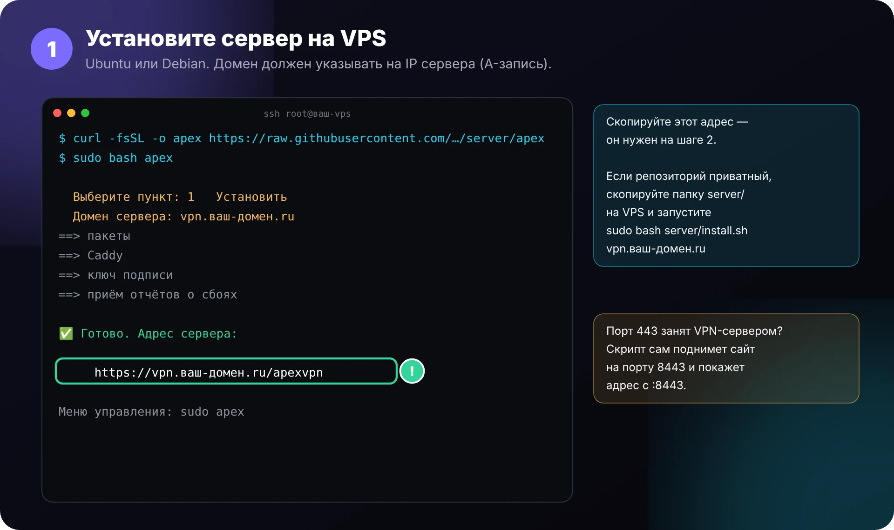
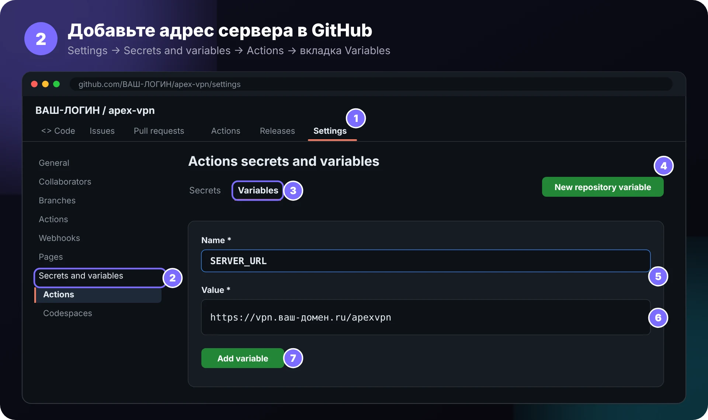
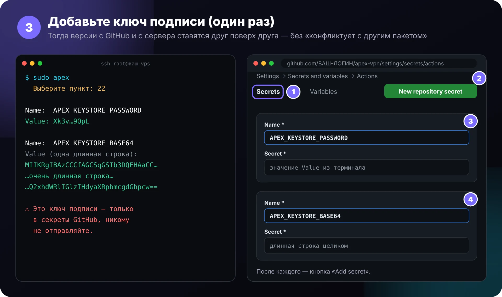
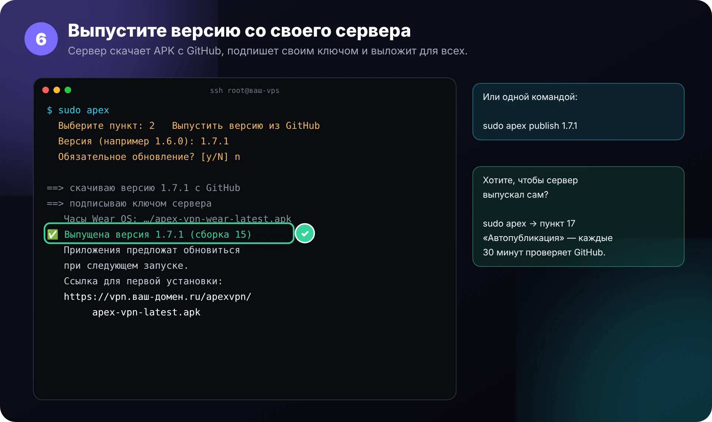
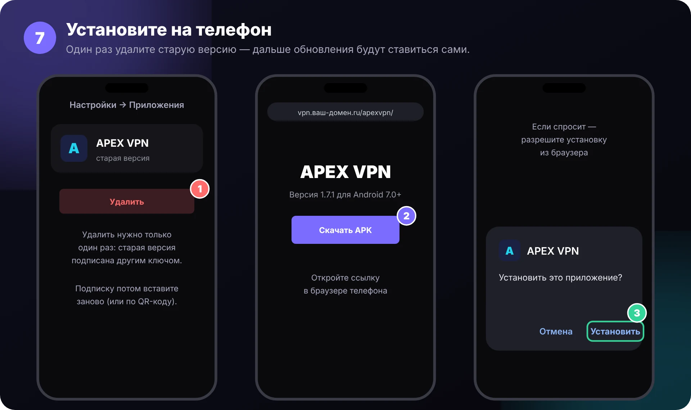

<div align="center">

# 📘 Инструкция: от сервера до телефона

<sub>7 шагов. Первые три делаются один раз, дальше — только шаги 4–6 для каждой новой версии (или автопубликация).</sub>

</div>

---

### Шаг 1. Установите сервер на VPS



```bash
curl -fsSL -o apex https://raw.githubusercontent.com/Dubstep2004/apex-vpn/main/server/apex && sudo bash apex
```

В меню выберите **1**, введите домен. В конце скрипт напечатает адрес вида `https://vpn.ваш-домен.ru/apexvpn` — скопируйте его.

> [!TIP]
> Репозиторий приватный? Тогда ссылка выше не откроется. Скопируйте папку `server/` на VPS и запустите `sudo bash server/install.sh vpn.ваш-домен.ru`.

---

### Шаг 2. Адрес сервера → GitHub



**Settings → Secrets and variables → Actions → Variables → New repository variable**

| Name | Value |
|---|---|
| `SERVER_URL` | адрес из шага 1, например `https://vpn.ваш-домен.ru/apexvpn` |

---

### Шаг 3. Ключ подписи → GitHub (один раз)



На VPS: `sudo apex` → пункт **22**. Скрипт покажет два значения. В GitHub: **Settings → Secrets and variables → Actions → Secrets → New repository secret**:

| Name | Secret |
|---|---|
| `APEX_KEYSTORE_PASSWORD` | значение `Value` из терминала |
| `APEX_KEYSTORE_BASE64` | длинная строка целиком |

> [!IMPORTANT]
> Этот шаг убирает ошибку **«Приложение не установлено, так как оно конфликтует с другим пакетом»**: все версии — и с GitHub, и с сервера — подписаны одним ключом. Ключ никому не отправляйте.

---

### Шаг 4. Запустите сборку


**Actions → Build APEX VPN → Run workflow → Run workflow**. Или просто запушьте изменения в `main`. Сборка идёт около 25 минут.

---

### Шаг 5. Проверьте Releases


В **Releases** появится `apex-vpn-<версия>.apk`. Запомните номер версии.

---

### Шаг 6. Выпустите версию со своего сервера



```bash
sudo apex publish 1.7.1
```

Или `sudo apex` → пункт **2**. Чтобы сервер делал это сам — пункт **17** «Автопубликация».

---

### Шаг 7. Установите на телефон



1. **Один раз** удалите старую версию APEX VPN (она подписана другим ключом).
2. Откройте на телефоне `https://vpn.ваш-домен.ru/apexvpn/` → **Скачать APK**.
3. Установите. Ссылку подписки вставьте заново или отсканируйте QR-код.

Дальше обновления приходят сами: приложение скачает новую версию и откроет установщик.

---

<div align="center"><sub><a href="../README.md">← назад к README</a> · <a href="../server/README.md">Команды сервера</a></sub></div>
